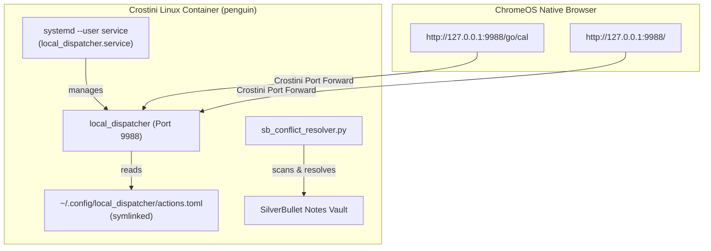

# Test Plan: Local Dispatcher & SilverBullet Conflict Resolver

## 1. Overview & Objectives
This test plan validates the end-to-end functionality of:
1. **Local Dispatcher (Rust Axum)** running as a systemd user daemon on port `9988` inside ChromeOS Crostini (`penguin`).
2. **Shortlink Redirects & Port Forwarding** (`/go/cal` and other routes) accessible from the native ChromeOS Chrome browser.
3. **Shared Configuration & Symlink Fidelity** between the Mac repo (`ap-macbook-setup`) and Crostini (`~/.config/local_dispatcher/actions.toml`).
4. **SilverBullet Conflict Resolver & Diff Tool** (`sb_conflict_resolver.py`), verifying detection and resolution of Syncthing and FreeFileSync conflict files.

---

## 2. Test Architecture

---

## 3. Test Suites & Test Cases

### Suite 1: Local Dispatcher & Systemd Lifecycle
| Test ID | Test Scenario | Steps / Command | Expected Result | Pass/Fail |
| :--- | :--- | :--- | :--- | :--- |
| **TC-1.1** | Service Persistence & Status | `systemctl --user status local_dispatcher` | Service is `active (running)` with no crash loops. | |
| **TC-1.2** | Auto-Restart on Process Kill | `kill -9 $(pgrep local_dispatche)` then wait 3s, verify status. | Systemd restarts daemon within 3 seconds with a new PID. | |
| **TC-1.3** | Boot / Container Startup Persistence | Check `systemctl --user is-enabled local_dispatcher`. | Reports `enabled`. Runs automatically on container start. | |
| **TC-1.4** | Port Binding Verification | `ss -tulpn \| grep 9988` or `lsof -i :9988` | Bound exclusively to `127.0.0.1:9988`. | |

---

### Suite 2: Shortlink & HTTP Redirect Endpoints
| Test ID | Test Scenario | Steps / Command | Expected Result | Pass/Fail |
| :--- | :--- | :--- | :--- | :--- |
| **TC-2.1** | Calendar Shortlink (`/go/cal`) | `curl -sI http://127.0.0.1:9988/go/cal` | Returns `HTTP/1.1 307 Temporary Redirect` with `location: https://calendar.google.com/calendar/u/0/r`. | |
| **TC-2.2** | Other Configured Aliases | Query `/go/silverbullet` and `/go/syncthing` via `curl -sI`. | Returns 307 redirects to `127.0.0.1:3000` and `127.0.0.1:8384` respectively. | |
| **TC-2.3** | Invalid Alias Handling | `curl -sI http://127.0.0.1:9988/go/nonexistent` | Returns `HTTP/1.1 404 Not Found` with a friendly error page. | |
| **TC-2.4** | Native ChromeOS Browser Access | Open `http://127.0.0.1:9988/go/cal` in ChromeOS native browser. | Page immediately redirects and loads Google Calendar in Chrome. | |
| **TC-2.5** | Web Dashboard | Open `http://127.0.0.1:9988/` in browser. | Dark/light dashboard displays cards for all actions and shortlinks. | |

---

### Suite 3: Shared Code & Symlink Fidelity
| Test ID | Test Scenario | Steps / Command | Expected Result | Pass/Fail |
| :--- | :--- | :--- | :--- | :--- |
| **TC-3.1** | Symlink Integrity | `readlink -f ~/.config/local_dispatcher/actions.toml` | Resolves to canonical path in `devices/ap-macbook-setup/tools/local_dispatcher/actions.toml`. | |
| **TC-3.2** | Shared Config Modification | Add a temporary alias `testlink = "https://example.com"` to `actions.toml`, restart service, and `curl /go/testlink`. | Returns 307 redirect to `https://example.com`. Both Mac and Linux see the change. | |
| **TC-3.3** | Cross-Platform Action Safety | Trigger `/run/sync` on Crostini. | Validates whether macOS `open -a FreeFileSync` fails gracefully or if a Linux override is executed without crashing the server. | |

---

### Suite 4: SilverBullet Conflict Resolver & Diff Tool
| Test ID | Test Scenario | Steps / Command | Expected Result | Pass/Fail |
| :--- | :--- | :--- | :--- | :--- |
| **TC-4.1** | Clean Vault Scan | Run `sb_conflict_resolver.py --scan` on empty/conflict-free vault. | Prints clean status: `0 sync conflicts found`. | |
| **TC-4.2** | Syncthing Conflict Detection | Create mock `Note.md` and `Note.sync-conflict-20261117-120000-NODE1.md`, then run `--scan`. | Detects 1 Syncthing conflict matching `Note.md`. | |
| **TC-4.3** | FreeFileSync Conflict Detection | Create mock `Note (Conflict 2026-11-17).md`, then run `--scan`. | Detects FreeFileSync style conflict copy. | |
| **TC-4.4** | Visual HTML Diff Generation | Run test generating diff between original and conflict note. | Produces standard 2-column side-by-side diff with colored additions/deletions. | |
| **TC-4.5** | Resolution: Keep Local | Execute `resolve_conflict(..., action="keep_local")`. | Conflict file deleted; original note preserved intact. | |
| **TC-4.6** | Resolution: Accept Remote | Execute `resolve_conflict(..., action="accept_remote")`. | Original note content updated to match conflict file; conflict file purged. | |

---

## 4. Execution Schedule & Rollout
1. **Automated Sanity Pass**: Run automated bash test suite covering Suites 1, 2, and 4.
2. **Manual UX Verification**: Launch Chrome browser on ChromeOS and confirm `/go/cal` redirect and dashboard UI.
3. **Cross-Platform Verification**: Sync `actions.toml` changes between MacBook and Chromebook.
